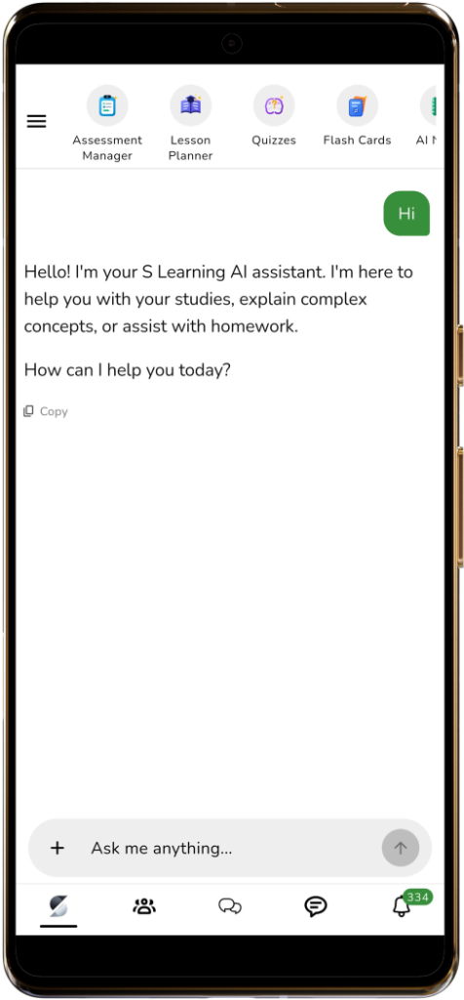
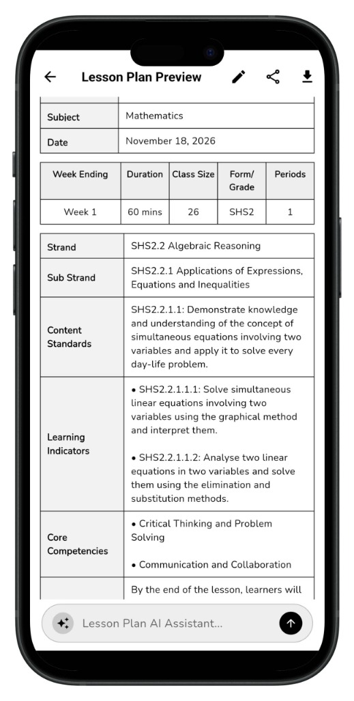
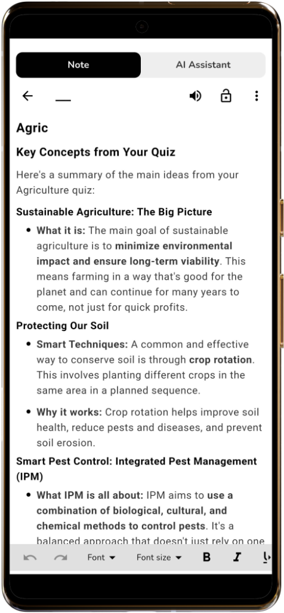
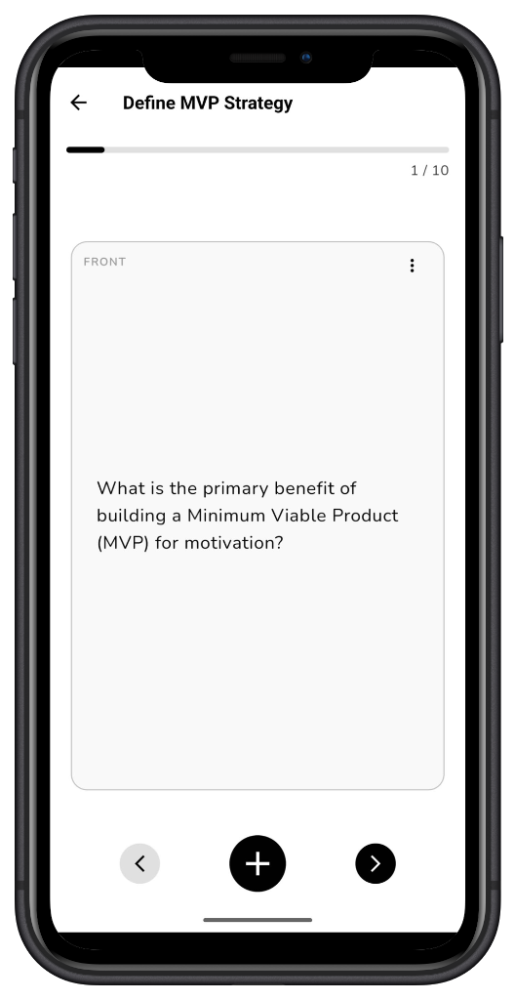

# Innocent Agbadi

### AI & Mobile Systems Engineer | Flutter & Dart 3 | Google Cloud Vertex AI & Firebase | Clean Architecture

**Ghana / Remote** &nbsp;|&nbsp; **Production AI & Mobile Systems** &nbsp;|&nbsp; **Software Engineer**

---

## About Me

I am an **AI and Mobile Systems Engineer** focused on designing reliable, production-ready intelligent applications and distributed mobile systems across **EdTech**, **FinTech / Microfinance**, **Civic Cryptography**, and **Service Marketplaces**.

- **Applied AI Systems Engineering:** Experienced in building deterministic LLM orchestration pipelines with **Google Cloud Vertex AI** (`gemini-3.1-flash-lite`), dense vector embeddings (`gemini-embedding-001`), **Cosine KNN vector search**, schema-constrained JSON generation, defensive score verification guardrails, and non-blocking token telemetry.
- **Production Cross-Platform Delivery:** End-to-end engineering from architectural design and offline local persistence (`SQLite`) to **Firebase** backends, **Cloud Functions v2 (TypeScript)**, **Google Cloud Platform**, and live releases on **Google Play** and the **Apple App Store**.
- **Software Craft and Security:** Committed to **Feature-First Clean MVVM**, **Dart 3 Sealed States**, dependency injection (`get_it`), declarative RBAC security rules, and hardware-backed local cryptography.

---

## Tech Stack & Tools

**AI & Machine Learning**  

**Mobile & Frontend**  

**Backend, Cloud & Security**  

---

## Featured Projects & Technical Case Studies

> **Portfolio Note:** To protect client confidentiality and commercial intellectual property, the full source code repositories for production and client engagements remain private. Complete technical architecture case studies, system diagrams, verification algorithms, and UI mockups are documented publicly in [`case-studies/`](./case-studies/). Full repository access can be provisioned upon request for graduate admissions or technical review.

---

### 1. S-Learning — AI-Powered Adaptive Educational Ecosystem *(Flagship Production App)*

> Live cross-platform mobile application combining Google Cloud Vertex AI, dense vector embeddings, and structured LLM orchestration to deliver automated subjective grading, adaptive quiz generation, and semantic search.

- **Links:**
  
  
  
  

| AI Tutor and Tool Hub | Curriculum-Aligned Lesson Planner | AI-Synthesized Study Notes | AI Flashcard Generator |
| :---: | :---: | :---: | :---: |
|  |  |  |  |

- **Key AI & Engineering Highlights:**
  - **Server-Side Subjective Assessment Orchestrator:** Automates open-ended quiz grading using Vertex AI (`gemini-3.1-flash-lite`, `temperature: 0.1`, JSON Response Schema) with server-side authoritative rubric hydration, exponential backoff retries, 45-second timeout guards, defensive score clamping (`[0, totalMarks]`), atomic Firestore `WriteBatch` persistence, and Node.js unit tests.
  - **Semantic Search & Vector Recommendation Engine:** Uses a pooled Vertex AI `gemini-embedding-001` client paired with native Firestore Cosine KNN retrieval (`findNearest`) for personalized feeds, semantic forum search, and course discovery.
  - **Adaptive Quiz Engine:** Dynamically synthesizes question batches conditioned on learner history, difficulty, and XP across 6 rotating modalities using type-scoped JSON schemas and multimodal document ingestion (PDF, DOCX, PPTX, URLs).
  - **AI Token Telemetry & Governance:** Records non-blocking daily token and image metrics (`TokenUsageTracker`) per AI tool alongside Firebase App Check, Crashlytics, and Eventarc triggers.

---

### 2. Desiadenyo Susu Service — Digital Microfinance and Field Ledger Platform

> Client-commissioned financial ledger platform digitizing informal rotating savings (Susu) operations for field agents and microfinance administrators.

- **Documentation:**
  
  `Private Client Production` &nbsp;|&nbsp; *Flutter • Dart 3 • Provider • Firebase Auth • Cloud Firestore*

- **Key Engineering Highlights:**
  - **Feature-First Clean MVVM:** Strict `data/`, `domain/`, and `presentation/` boundaries with abstract repository contracts, zero `BuildContext` in ViewModels, and **Dart 3 `sealed class` states**.
  - **Multi-Tier RBAC & Immutable Ledger:** Distinct workflows for Field Agents and Administrators enforced by hardened `firestore.rules`, immutable transaction entries, and non-destructive compensating reversals with audit notes.
  - **Analytics & Reconciliation:** 30-day cash flow trend visualization (`fl_chart`), drill-down transaction audits, and CSV report exporting.

---

### 3. GNATOC Voting System — Secure On-Campus Digital Election Platform

> Production-complete, cryptographically hardened electronic voting kiosk and election administration system built for the Ghana National Association of Teachers On Campus (GNATOC).

- **Documentation:**
  
  `Private / Production Complete` &nbsp;|&nbsp; *Flutter • Cloud Firestore Transactions • Crypto • Secure Storage • TTS*

- **Key Engineering Highlights:**
  - **Atomic Double-Vote Race Prevention:** Uses server-only queries (`Source.server`) and reads-first Firestore `runTransaction` locks over `votes/{voterId}` audit documents to guarantee single-vote consistency across concurrent kiosks.
  - **Constitutional Ballot Secrecy:** Decouples anonymized voter audit receipts from candidate vote tallies while preserving verifiable participation logs.
  - **Hardware Kiosk Hardening & A11y:** Enforces salted SHA-256 device PINs stored in OS keychains (`flutter_secure_storage`), kiosk lockdown (`wakelock_plus`, `flutter_window_close`), Text-to-Speech ballot guidance (`flutter_tts`), real-time `fl_chart` analytics, and certified PDF election reports.

---

### 4. HairHQ — On-Demand Beauty Services and Salon Booking Platform *(In Development)*

> Architectural prototype and active development codebase for a two-sided salon appointment and mobile stylist marketplace.

- **Documentation:**
  
  `Private / In Development` &nbsp;|&nbsp; *Flutter • Dart 3 • Provider • GetIt DI • SharedPreferences*

- **Key Engineering Highlights:**
  - **Clean Architecture Prototype:** Built on Feature-First Clean MVVM, `get_it` service locator dependency injection, Dart 3 sealed states, and centralized constant/theme token managers.
  - **Preference-Driven Onboarding Engine:** Interactive multi-step user preference configuration and live feed personalization preview.

---

## GitHub Activity

---

## Let's Connect

- **LinkedIn:** [linkedin.com/in/innocent-agbadi-080222350](https://www.linkedin.com/in/innocent-agbadi-080222350)
- **Email:** [stonard5560@gmail.com](mailto:stonard5560@gmail.com)
- **Location:** Ghana (Available for Remote Opportunities & Graduate Research)
