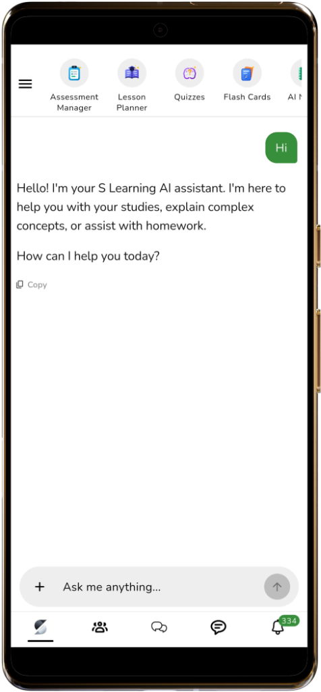
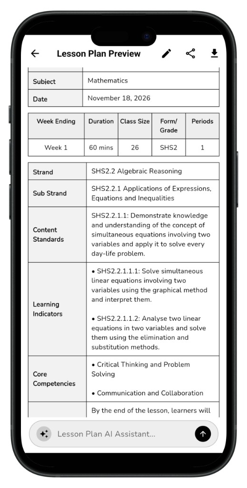
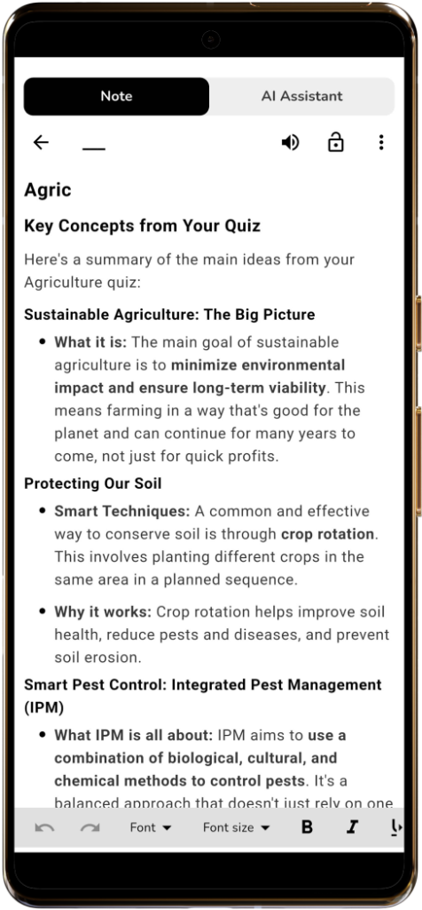
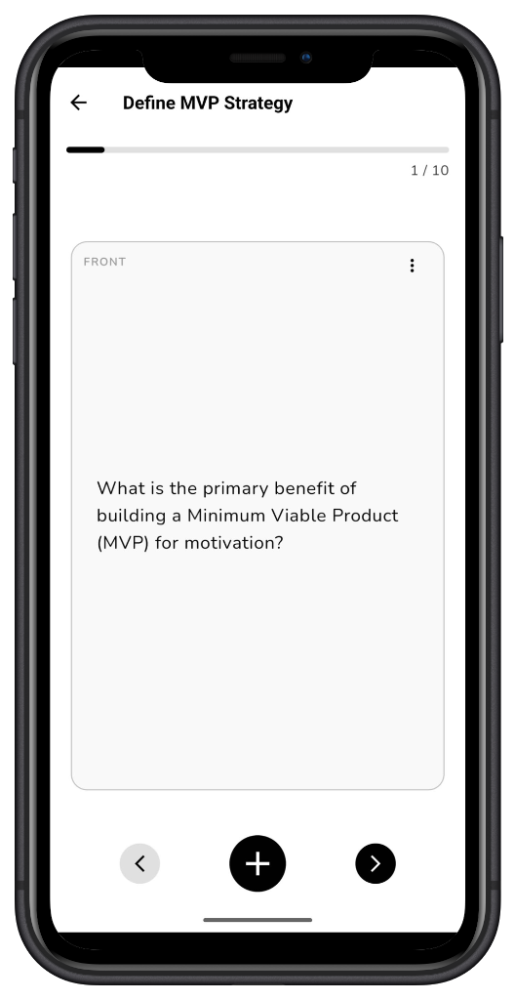

[Back to Profile Overview](../README.md)

# S-Learning: AI-Powered Adaptive Educational Ecosystem

[](https://play.google.com/store/apps/details?id=com.agbadiinnocent.slearning)
[](https://apps.apple.com/app/s-learning/id6764841176)
[](https://flutter.dev)
[](https://www.typescriptlang.org/)
[](https://cloud.google.com/)
[](https://cloud.google.com/vertex-ai)
[](https://firebase.google.com/)

**S-Learning** is a production cross-platform mobile application (live on Google Play and the Apple App Store) that integrates Google Cloud Vertex AI, dense vector embeddings, and structured LLM orchestration to deliver automated subjective grading, adaptive quiz generation, semantic content discovery, and multimodal study tools.

---

## Abstract and Problem Statement

Conventional educational technology platforms scale well for deterministic, multiple-choice assessments but struggle with three core bottlenecks:
1. **Subjective Grading at Scale:** Evaluating open-ended student responses requires rubric alignment, partial-credit reasoning, and safeguards against hallucinated or out-of-bounds scores.
2. **Static Assessment Paths:** Fixed question banks fail to adapt question format and difficulty to a learner's real-time performance history.
3. **Keyword-Limited Knowledge Discovery:** Traditional lexical search misses conceptual similarity across student questions, study communities, and learning resources.

S-Learning addresses these challenges through an event-driven, production AI architecture combining **deterministic schema-constrained LLM inference**, **Cosine KNN vector search**, and **multimodal document ingestion**.

---

## Application Preview

| AI Tutor and Tool Hub | Curriculum-Aligned Lesson Planner | AI-Synthesized Study Notes | AI Flashcard Generator |
| :---: | :---: | :---: | :---: |
|  |  |  |  |

---

## Core AI and Machine Learning Systems

### 1. Server-Side Subjective Assessment Orchestrator
Located in `functions/src/assessment_services/`, this event-driven pipeline automates the grading of open-ended quiz submissions (`onAttendanceDocumentCreated`) and supports on-demand re-evaluation (`remarkScriptEurope`).

- **Precondition and Idempotency Guards (`marking_orchestrator.ts`):** Verifies marking state, `isAiMarkingEnabled` flags, and unanswered item status before invoking inference.
- **Authoritative Rubric Hydration:** Overlays teacher-authored rubrics, model answers, and maximum mark allocations directly from the parent quiz document on the server, preventing client-side tampering.
- **Deterministic Structured Inference (`ai_evaluator.ts`, `marking_schema.ts`):** Invokes Vertex AI (`gemini-3.1-flash-lite` on the global endpoint) with `temperature: 0.1`, `responseMimeType: "application/json"`, and a strict JSON response schema. Inference calls are wrapped in exponential backoff retries and a 45-second `Promise.race` timeout guard.
- **Defensive Score Verification and Clamping (`score_verifier.ts`):** Sanitizes raw JSON outputs, validates question IDs, deterministically assigns zero to unanswered items, clamps awarded marks strictly within `[0, totalMarks]` with floating-point rounding safety, respects concurrent manual teacher grading, and synthesizes distinct `studentFeedback` and `teacherFeedback`.
- **Atomic Persistence and Automated Testing (`persistence.ts`, `__tests__/`):** Commits verified scores and feedback via lock-free Firestore `WriteBatch` operations, verified by Node.js unit tests.

### 2. Semantic Search and Vector Recommendation Engine
Located in `functions/src/vertex_ai_services/`, `functions/src/post_services/`, and `functions/src/courses_services/`.

- **Dense Vector Embeddings (`generate_embeddings.ts`, `generate_search_vector.ts`):** Generates configurable-dimensionality text embeddings via Google Vertex AI (`gemini-embedding-001`) using a module-scoped pooled `PredictionServiceClient` (`europe-west1`) with exponential backoff and explicit `429` / `RESOURCE_EXHAUSTED` error translation.
- **Cosine K-Nearest Neighbors (KNN) Retrieval:** Executes native Firestore vector similarity queries (`findNearest` with `COSINE` distance) across indexed collections to power:
  - Personalized content-based feed recommendations (`getRecommendedPostsEurope`) conditioned on user interest vectors.
  - Semantic forum post search (`knnSearchPostsEurope`).
  - Community and course discovery (`knnSearchCommunities`, `knnSearchComPost`).
- **Filtering and Safety:** Combines vector retrieval with user block-list exclusion and content-tier filtering.

### 3. Adaptive Quiz Generation Engine
Located in `lib/features/tools/quizzes/data/repo/adaptive_quiz_repository_impl.dart`.

- **Context-Aware Batch Synthesis:** Generates batches of adaptive questions conditioned on recent learner history, current difficulty level, accumulated XP, historical quiz performance summaries, and explicit learner feedback.
- **Dynamic Format Rotation and Token Optimization:** Cycles across six question modalities (`multipleChoice`, `trueFalse`, `multipleSelect`, `shortAnswer`, `orderingSequence`, `matching`) without consecutive repetition. Prompts and JSON schemas are scoped strictly to the selected question type, minimizing prompt bloat and output token latency.
- **Multimodal Source Ingestion:** Accepts PDF, DOCX, PPTX, web URLs, existing study notes, or freeform topics as grounding material.

### 4. Multimodal Generative AI Study Suite
Powered client-side via Firebase AI Logic (`firebase_ai`) with centralized schema definitions (`lib/core/services/ai/firebase_ai_schemas.dart`) and prompt templates.

- **Conversational AI Tutor:** Streaming assistant for conceptual explanations, homework guidance, and contextual Q&A.
- **Curriculum-Aligned Lesson Planner:** Generates structured pedagogical lesson plans (Strand, Sub-Strand, Content Standards, Learning Indicators, Core Competencies) with an inline iterative AI assistant for refinement and PDF export.
- **AI-Synthesized Rich-Text Notes:** Distills quiz results and uploaded documents into editable rich-text notes (`flutter_quill`, `markdown_quill`) with LaTeX mathematical rendering (`flutter_math_fork`) and Text-to-Speech synthesis (`flutter_tts`).
- **AI Flashcards:** Automatically constructs active-recall Q&A decks from documents, notes, or quizzes.

---

## System Architecture

```text
+-------------------------------------------------------------------------+
|                   Flutter Mobile Client (iOS / Android)                 |
|  Clean Architecture (core / features / shared) | Provider | get_it DI   |
|  SQLite (sqflite) | Quill Rich Text | LaTeX Math | TTS | Document OCR   |
+-------------------+-----------------------------------+-----------------+
                    |                                   |
                    | Direct Streaming /                | HTTPS Callable &
                    | Structured Gen                    | Realtime Sync
                    v                                   v
+---------------------------------------+  +------------------------------+
|     Firebase AI Logic (Gemini SDK)    |  |   Firebase Core Backend      |
|  - Conversational AI Tutor            |  |  - Authentication & AppCheck |
|  - Adaptive Quiz & Flashcard Gen      |  |  - Cloud Firestore (NoSQL +  |
|  - Lesson Plan & Note Synthesis       |  |    Vector Similarity Index)  |
|  - TokenUsageTracker Telemetry        |  |  - Cloud Storage & Eventarc  |
+---------------------------------------+  +--------------+---------------+
                                                          |
                                                          | Triggers / RPC
                                                          v
                                           +------------------------------+
                                           | Cloud Functions v2 (TS/Node) |
                                           |  - Subjective Marking Orch.  |
                                           |  - Score Verifier & Clamper  |
                                           |  - KNN Search & Recommender  |
                                           |  - Scheduled Jobs & Alerts   |
                                           +--------------+---------------+
                                                          |
                                                          | Pooled RPC +
                                                          | Backoff / Timeout
                                                          v
                                           +------------------------------+
                                           |   Google Cloud Vertex AI     |
                                           |  - gemini-3.1-flash-lite     |
                                           |  - gemini-embedding-001      |
                                           +------------------------------+
```

---

## AI Engineering, Reliability, and Observability

- **Non-Blocking Token Telemetry (`TokenUsageTracker`):** Atomically records daily `input_tokens`, `output_tokens`, `total_tokens`, `request_count`, and `image_count` per AI tool in Firestore using fire-and-forget writes (`unawaited`), providing cost visibility without adding user-facing latency.
- **Fault Tolerance and Rate-Limit Handling:** Both client and server AI layers implement exponential backoff, timeout safeguards, and graceful degradation under quota exhaustion (`RESOURCE_EXHAUSTED`).
- **Security and Quota Governance:** Enforces Firebase App Check attestation, pre-inference daily limit and credit verification, and server-side hydration of sensitive grading rubrics.
- **Production Operations:** Instrumented with Firebase Crashlytics, Firebase Performance Monitoring, Remote Config, Cloud Scheduler background jobs, and Eventarc-triggered media processing (`on_image_resize_success`).

---

## Repository Structure

```text
S-Learning/
├── lib/
│   ├── core/
│   │   ├── constants/              # App, Firestore, and model configuration constants
│   │   ├── di/                     # Dependency injection container (get_it)
│   │   ├── services/ai/            # FirebaseAIServices, JSON schemas, prompts, TokenUsageTracker
│   │   └── utils/                  # Document extraction (PDF/DOCX/PPTX), retry backoff, exceptions
│   ├── features/
│   │   ├── pages/                  # AI Tutor Hub, Communities, Forum, Chats, Inbox
│   │   └── tools/                  # Assessment Manager, Lesson Plan, Adaptive Quizzes, Flashcards, Notes
│   └── shared/                     # Shared models, repositories, and UI components
├── functions/
│   └── src/
│       ├── assessment_services/    # Subjective marking orchestrator, AI evaluator, score verifier, unit tests
│       ├── vertex_ai_services/     # Pooled Gemini embedding client and search vector generator
│       ├── post_services/          # Cosine KNN post search and vector recommendation engine
│       ├── courses_services/       # Community/course KNN search and lifecycle triggers
│       ├── scheduler_jobs/         # Cron-scheduled engagement and feed maintenance jobs
│       └── event_arc_services/     # Eventarc storage processing handlers
└── docs/images/                    # Application interface mockups
```

---

## Technology Stack

| Layer | Technologies |
| :--- | :--- |
| **Mobile Client** | Flutter, Dart 3, Provider, `get_it`, SQLite (`sqflite`), `flutter_quill`, `flutter_math_fork`, `flutter_tts` |
| **Generative AI & ML** | Google Cloud Vertex AI (`@google-cloud/vertexai`, `@google-cloud/aiplatform`), Firebase AI Logic (`firebase_ai`), Gemini Flash / Flash-Lite models, `gemini-embedding-001` |
| **Vector Search & Data** | Cloud Firestore (Document Store + Cosine KNN Vector Indexes), Firebase Storage |
| **Backend & Orchestration** | Firebase Cloud Functions v2 (Node.js 22, TypeScript), Eventarc, Cloud Scheduler |
| **Observability & Security** | Firebase App Check, Crashlytics, Performance Monitoring, Analytics, Custom Token Telemetry |

---

## Academic and Research Relevance

This project demonstrates applied engineering across several areas central to graduate study in Artificial Intelligence:
- **Reliable LLM Evaluation and Guardrails:** Designing low-temperature, schema-constrained grading pipelines paired with deterministic verification layers to mitigate hallucination and scoring drift.
- **Information Retrieval and Representation Learning:** Operationalizing dense semantic embeddings and approximate/exact KNN vector search in a multi-tenant production database.
- **Adaptive Educational Systems:** Modeling dynamic difficulty and question-type selection conditioned on learner interaction history under real-world token and latency budgets.
- **End-to-End ML Systems Engineering:** Bridging model inference with telemetry, fault tolerance, security, and live cross-platform deployment serving real users.
